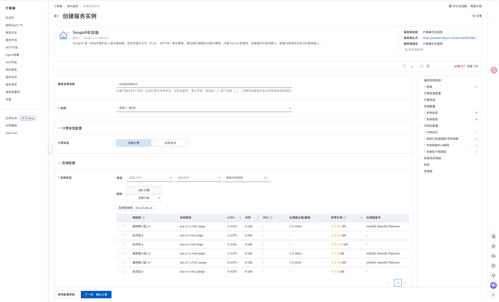
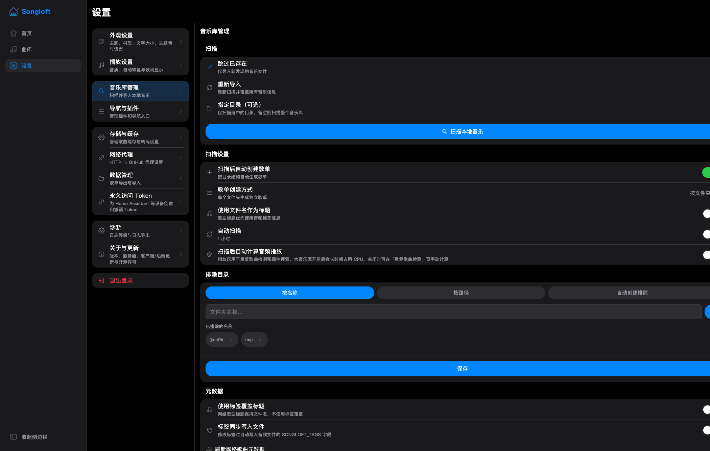

# Deploying Songloft on Alibaba Cloud Compute Nest

## About the service

Songloft is an open-source, self-hosted personal music server written in Go with a built-in SQLite database and no external database dependency. Point it at a folder of your own music files and it scans and indexes metadata and cover art, then serves the library through a web UI that phones, computers and TVs can connect to.

This Compute Nest service deploys a single ECS instance. The image already contains Songloft and its Docker Compose runtime, and both the library database and the music files stay on the instance system disk.

Note that this service ships no music content of any kind: the music directory is empty by default and you upload files you legally own. The upstream project states that it is intended for personal, non-commercial use, so confirm your scenario fits those terms before purchasing.

Songloft is served on port 58091 of the instance public IP. The username is always `admin`; the password is generated during deployment and listed in the service instance outputs.

## Billing

Creating a service from this template is free. Running a service instance incurs:

- ECS instance (minimum 2 vCPU, 4 GiB memory)
- System disk (fixed at 200 GiB ESSD by the template)
- Public bandwidth (fixed at 5 Mbps by the template)

Both pay-as-you-go and subscription are supported; the estimate is shown before you confirm the order.

## Required RAM permissions

If you create the instance with a RAM user, grant the following policies first.

| Policy | Purpose |
| --- | --- |
| AliyunECSFullAccess | Manage ECS instances |
| AliyunVPCFullAccess | Manage VPC resources |
| AliyunROSFullAccess | Manage Resource Orchestration Service stacks |
| AliyunComputeNestUserFullAccess | Manage Compute Nest user-side resources |

## Deployment steps

1. Open the instance creation page, choose a region, and specify the instance type and instance password. You can create a new VPC or use an existing VPC and vSwitch.

   [Deploy now](https://computenest.console.aliyun.com/service/instance/create/cn-hangzhou?type=user&ServiceId=service-020cdf9770534de0a7d8)

   

2. Review the price estimate, choose **Next: Confirm Order**, accept the service agreement and click **Create Now**.

3. Wait for the deployment to finish. The **Outputs** section of the instance details page lists `songloft_58091_url`, `AdminUsername` and `AdminPassword`, plus several notes on the music directory, telemetry and licensing that are worth reading.

4. Open the URL from the outputs (`http://<public-ip>:58091`). The first sign-in asks you to accept the user agreement; then sign in as `admin` with the generated password to reach the home page.

## First steps

### Upload music and scan

The music directory is `/opt/songloft/music` on the instance (`/app/music` inside the container, already configured, so you do not need to fill it in on the settings page). Upload files with SCP, SFTP or rsync, then click **Scan local music** under **Settings → Music library**. Cover art and metadata are extracted automatically. MP3, FLAC, WAV, APE, OGG and DSD are among the supported formats.

### Data persistence

The database, configuration and cover cache live in `/opt/songloft/data`; music files live in `/opt/songloft/music`. `docker compose down` and container rebuilds keep the data; releasing the instance deletes both directories, so back them up regularly.

### Change the admin password

There is no password change screen. Edit `ADMIN_PASSWORD` in `/opt/songloft/.env` on the instance, then run `cd /opt/songloft && docker compose up -d` to recreate the container.

### Runtime telemetry and outbound access

The official image injects Tracely runtime monitoring at build time. The upstream privacy notice says it reports the version, runtime platform, hostname and activity heartbeat, and there is no runtime switch to turn it off in the current release. To block it entirely, restrict the instance's outbound traffic with security groups or network ACLs.

### Plugins and upgrades

Capabilities such as the Subsonic-compatible API and WebDAV ship as official plugins rather than being bundled in the image; upload the corresponding plugin package on the plugin page to enable them. Licensing and content compliance for third-party plugins are the operator's responsibility. The admin UI offers a version check and an upgrade entry point for Docker deployments; back up the data directory first and make sure the instance can reach the upstream distribution source.

## Parameters

| Parameter | Description | Default |
| --- | --- | --- |
| VpcOption | Create a new VPC or reuse an existing one | NewVPC |
| VpcCidrBlock | CIDR block of the new VPC | 192.168.0.0/16 |
| VSwitchCidrBlock | CIDR block of the new vSwitch | 192.168.1.0/24 |
| EcsInstanceType | ECS instance type, 2–4 vCPU ecs.u1 / ecs.e families | none |
| InstancePassword | Password for the ECS instance | none |
| PayType | Billing method | PostPaid |
| ZoneId | Availability zone | none |
| VpcId / VSwitchId | Existing VPC and vSwitch (when reusing a VPC) | empty |

## Outputs

| Output | Description |
| --- | --- |
| songloft_58091_url | Library URL (port 58091) |
| AdminUsername | Admin username (`admin`) |
| AdminPassword | Admin password (generated at deployment) |
| QuickStartGuide / MusicDirNote / DataPersistenceNote / PasswordNote | Sign-in, music directory, data persistence and password notes |
| TelemetryNote / GplFfmpegNote / PluginNote / UpgradeNote / SourceLicenseNote | Telemetry, ffmpeg licensing, plugins, upgrades and source licensing notes |

## Security notes

- Do not share the admin password; if it leaks, change it as described above.
- You are responsible for the copyright and compliance of the music in the library. This service ships no music content.
- The main application is Apache-2.0 licensed; the bundled ffmpeg and ffprobe are built with GPL options, so redistributing the image must follow GPL terms.
- This service is built on the open-source Songloft project and has no affiliation with or endorsement from the upstream project or its authors.

## Troubleshooting

**The library is empty after sign-in.** The music directory starts empty. Upload files to `/opt/songloft/music` and trigger a scan.

**Newly uploaded tracks are not found.** Make sure the files are under `/opt/songloft/music` and readable by the container, then run the scan again. If you changed the music directory, update it on the settings page before scanning.

**Is data durable across restarts?** Yes. Data and music live in `/opt/songloft/data` and `/opt/songloft/music`; only releasing the instance deletes them.

## Links

- Source code: https://github.com/songloft-org/songloft
- Website and documentation: https://songloft.hanxi.cc/
- License: Apache-2.0 (main application)
