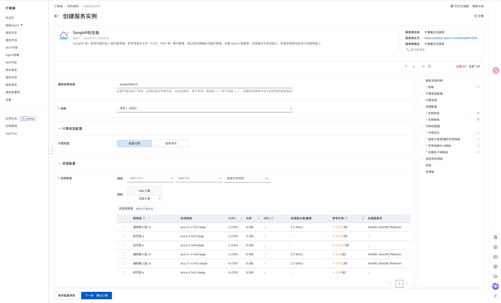
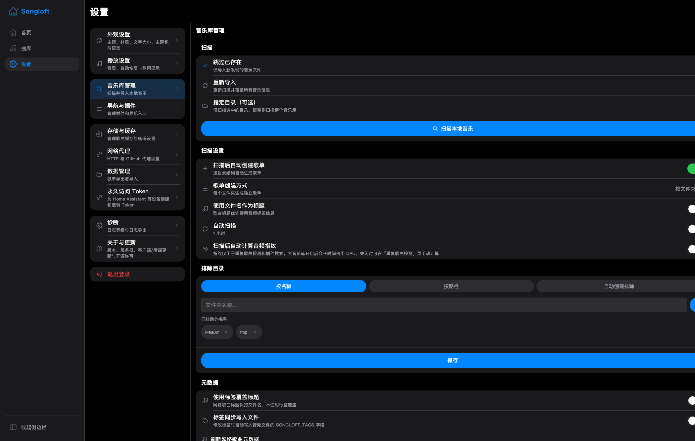

# Songloft 计算巢部署文档

## 服务说明

Songloft 是一款开源自托管的个人音乐服务器，使用 Go 编写、内置 SQLite，无外部数据库依赖。把自有音乐文件放进服务器的音乐目录，它会扫描并索引元数据与封面，生成一个通过网页访问的私人曲库；手机、电脑、电视等客户端连上同一台服务器即可播放。

本计算巢服务采用单机 ECS 部署，ECS 镜像内已预置 Songloft 与 Docker Compose 运行环境，曲库数据与音乐文件都保存在实例系统盘，不经过任何第三方存储服务。

需要注意：本服务不提供任何音乐内容，音乐目录出厂为空，需要自行上传合法拥有的音乐文件；上游文档声明适用于个人非商业使用，购买前请确认使用场景符合上游授权条款。

访问入口为实例公网 IP 的 58091 端口，用户名固定为 `admin`，密码在部署时随机生成并展示在实例输出中。

## 计费说明

通过此服务模板构建服务不产生费用。用户部署服务实例时，资源费用主要涉及：

- ECS 实例规格（最低 2 vCPU、4 GiB 内存）
- 系统盘容量（模板固定 200 GiB ESSD）
- 公网带宽（模板固定 5 Mbps）

计费方式支持按量付费和包年包月，预估费用会在部署前实时展示。

## RAM账号所需权限

若使用 RAM 用户创建服务实例，需要在创建服务实例前为该 RAM 用户添加相应权限。

| 权限策略名称 | 备注 |
| --- | --- |
| AliyunECSFullAccess | 管理云服务器 ECS 的权限 |
| AliyunVPCFullAccess | 管理专有网络 VPC 的权限 |
| AliyunROSFullAccess | 管理资源编排 ROS 的权限 |
| AliyunComputeNestUserFullAccess | 管理计算巢服务用户侧资源的权限 |

## 服务实例部署流程

### 部署步骤

1. 打开计算巢服务实例创建页面，选择部署地域，填写实例规格、实例密码。网络可选择新建 VPC，也可以选择已有的 VPC 与交换机。

   [部署链接](https://computenest.console.aliyun.com/service/instance/create/cn-hangzhou?type=user&ServiceId=service-020cdf9770534de0a7d8)

   

2. 确认询价明细后点击 **下一步：确认订单**，同意服务协议并点击 **立即创建**。

3. 等待服务实例部署完成。部署完成后，在服务实例详情页的 **输出** 区域查看 `songloft_58091_url` 访问地址、`AdminUsername` 用户名与 `AdminPassword` 管理员密码；输出中还有若干条使用说明（音乐目录、遥测、许可等），建议一并阅读。

4. 用浏览器打开输出中的访问地址（`http://<实例公网IP>:58091`），首次登录会要求勾选用户协议；使用用户名 `admin` 与输出中的管理员密码登录，即可进入首页。

## 首次使用说明

### 1. 上传音乐并扫描

音乐目录为实例上的 `/opt/songloft/music`（容器内对应 `/app/music`，已预置在配置中，无需在设置页手工填写）。通过 SCP、SFTP 或 rsync 把音乐文件上传到该目录，然后在 **设置 → 音乐库管理** 点击 **扫描本地音乐**，封面与元数据会被自动提取入库。扫描支持 MP3、FLAC、WAV、APE、OGG、DSD 等常见格式。

### 2. 数据持久化

数据库、配置与封面缓存保存在 `/opt/songloft/data`，音乐文件在 `/opt/songloft/music`。执行 `docker compose down` 或重建容器不会丢数据；释放服务实例时两个目录会一并删除，请定期备份。

### 3. 修改管理员密码

系统未提供界面改密入口。如需更换密码，登录实例编辑 `/opt/songloft/.env` 中的 `ADMIN_PASSWORD`，然后执行 `cd /opt/songloft && docker compose up -d` 重建容器生效。

### 4. 运行监控与出网

官方镜像在编译期注入了 Tracely 运行监控，上游隐私说明称会上报版本、运行平台、主机名与活跃心跳，当前版本没有运行期关闭开关。如需彻底阻断，请通过安全组或网络 ACL 限制实例的出方向访问。

### 5. 插件与升级

Subsonic 兼容接口、WebDAV 等能力以官方插件形式提供，未预置在镜像内，可在插件管理页上传对应插件包后启用；第三方插件的授权与内容合规由使用者自负。管理界面提供版本检查与 Docker 环境下的升级入口，升级前请先备份数据目录，并确认实例可访问上游分发源。

## 参数说明

| 参数 | 说明 | 默认值 |
| --- | --- | --- |
| VpcOption | 网络类型，新建 VPC 或使用已有 VPC | NewVPC |
| VpcCidrBlock | 新建 VPC 的网段 | 192.168.0.0/16 |
| VSwitchCidrBlock | 新建交换机的网段 | 192.168.1.0/24 |
| EcsInstanceType | ECS 实例规格，可选 2–4 vCPU 的 ecs.u1 / ecs.e 系列 | 无 |
| InstancePassword | 实例登录密码 | 无 |
| PayType | 付费类型 | PostPaid |
| ZoneId | 可用区 | 无 |
| VpcId / VSwitchId | 已有 VPC 与交换机 ID（选择已有 VPC 时填写） | 空 |

## 输出说明

| 输出 | 说明 |
| --- | --- |
| songloft_58091_url | 曲库访问地址（端口 58091） |
| AdminUsername | 管理员用户名（admin） |
| AdminPassword | 管理员密码（部署时随机生成） |
| QuickStartGuide / MusicDirNote / DataPersistenceNote / PasswordNote | 登录、音乐目录、数据持久化与改密说明 |
| TelemetryNote / GplFfmpegNote / PluginNote / UpgradeNote / SourceLicenseNote | 遥测出网、ffmpeg 许可、插件、升级与来源授权说明 |

## 安全与使用说明

- 请勿公开分享管理员密码；密码泄露后按上文方式在实例内更换。
- 曲库版权与合规由使用者自行负责，本服务不提供任何音乐内容。
- 主程序为 Apache-2.0 许可；镜像内 ffmpeg 与 ffprobe 以 GPL 选项构建，随镜像分发需遵循 GPL 要求。
- 本服务基于开源项目 Songloft 构建，与上游项目及作者无隶属或背书关系。

## 常见问题

**登录后曲库是空的？**
音乐目录出厂为空。先把文件上传到 `/opt/songloft/music`，再到设置页触发扫描。

**扫描不到新上传的歌曲？**
确认文件放在 `/opt/songloft/music` 下且容器对该目录有读权限，然后重新触发扫描；修改过音乐目录的，需要在设置页更新目录后再扫描。

**重启实例后数据还在吗？**
在。数据与音乐分别在 `/opt/songloft/data` 与 `/opt/songloft/music`；只有释放服务实例才会删除。

## 官方链接

- 官方仓库：https://github.com/songloft-org/songloft
- 官方网站与文档：https://songloft.hanxi.cc/
- 许可证：Apache-2.0（主程序）
